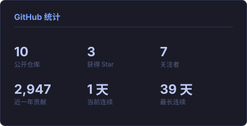
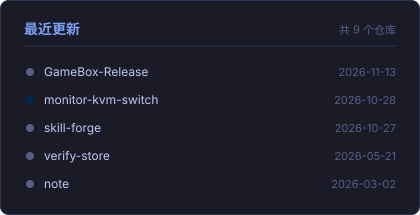
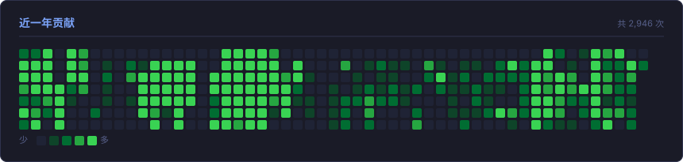
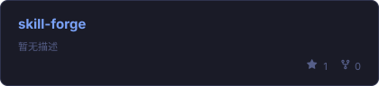
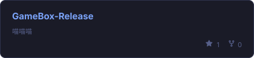
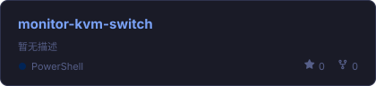
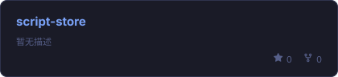

  

  
  

---

### 🧭 关于我

- 💻 主攻方向：**Java 后端开发** —— Spring Boot / Spring Cloud / MySQL / Redis
- 🎨 前端栈：**Vue 3** + Vite + Element Plus，能独立完成前后端联调与部署
- 🌱 正在打磨：`skill-forge`、`GameBox-Release`
- 🐾 业余爱好：**逆向工程** —— Android / 游戏 / 内核驱动，纯属兴趣驱动
- 💬 交流随时找我，Telegram 回得最快

---

### 🛠️ 技术栈

  

  
  
  
  
  
  
  
  
  

<b>🐾 业余折腾（逆向 / 安全）</b>

 

  
  
  
  
  
  
  

---

### 📊 GitHub 统计

<table>
  <tr>
    <td width="50%" align="center">
      
    </td>
    <td width="50%" align="center">
      
    </td>
  </tr>
  <tr>
    <td colspan="2" align="center">
      
    </td>
  </tr>
</table>

---

### 🚀 精选项目

<table>
  <tr>
    <td width="50%" align="center">
      
    </td>
    <td width="50%" align="center">
      
    </td>
  </tr>
  <tr>
    <td width="50%" align="center">
      
    </td>
    <td width="50%" align="center">
      
    </td>
  </tr>
</table>

---

### 📫 联系方式

| 平台 | 账号 |
|:---:|:---|
| Email | `18890176107@163.com` |
| Telegram | [@XGeorgeSE](https://t.me/XGeorgeSE) |

---

  

<i>感谢访问，祝你有美好的一天</i> 🐾

